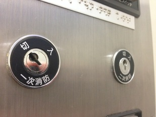

## そもそも：非常用エレベーターとは

高い建物には、ふだんのエレベーターとは別に「**非常用エレベーター**」がある。火事のとき、消防隊が消火や救助のために上の階へ行くためのもの。

- 高さ31mを超える建物には、設置が義務づけられている（例外もある）
- ふだんはだれでも人や荷物を運ぶのに使える。火事のときは消防隊が優先して使う
- かごの速さは分速60m以上。建物の外への出口から30m以内の場所に置く
- かごの中には、ふだんは使わない鍵穴が2つ並んでいる（このあと説明する一次消防と二次消防）

{{fig:fire-elevator-what}}

## 火事のときの使いかた（流れ）

1. 乗り場の「呼戻し運転」ボタンか、管理室の「非常呼戻」ボタンを入れる。エレベーターは避難階（ふつうは1階）へまっすぐ戻り、扉を開けて待つ
2. 消防隊がかごに乗り、中の**一次消防**スイッチを鍵で入れる。これで、かごの中の操作でしか動かなくなる（乗り場のボタンはきかない）
3. 行きたい階のボタンを**押し続ける**と、扉が閉まって動き出す
4. 目的の階に着いたら、開くボタンで扉を開ける（自動では開かない）
5. 熱などで扉が閉まらない・動かないときは、**二次消防**スイッチを鍵でひねり、行き先ボタンと一緒に3秒間押し続ける。扉が閉まらなくてもかごが動いて、目的の階に着く

{{fig:fire-elevator-flow}}

この流れの中で使う2つの鍵穴には、見ただけで違いがわかる工夫がある。

## 見るとわかること（2つの鍵穴）

非常用エレベーターのかご内には「一次消防」「二次消防」のキースイッチがある。

- 一次消防の鍵穴は、「切」か「入」の表示を指す斜めの向きで止まっている
- 二次消防の鍵穴は、どちらの表示も指していない向きが定位置

鍵穴が表示を指して止まる＝その位置で止まれる（トグル）。どちらも指していない＝ひねっても戻ってくる（モーメンタリ）。鍵穴の向きだけで、スイッチの振る舞いが読み取れる。

## なぜそうなっているか

- **一次消防**：かごの中からしか操作できない消防隊専用の運転。消防隊が活動中ずっと使うモードなので、入れっぱなしにできる。到着しても扉は自動で開かず、行先ボタンも扉が閉まるまで押し続ける必要があるなど、火災階の熱や煙を避ける安全側の操作になっている
- **二次消防**：一次消防運転中に、災害で扉が閉まらない・出発しないといった状態になったときの緊急手段。安全装置を止めて、扉を開けたままかごを昇降させる。危険な操作なので、スプリングバック式で「ひねって保持している間だけ」有効になり、手を離せば戻る
- 手順は「一次消防を入れたまま鍵を抜き、二次消防に差し替える」。つまり一次消防は「入」の位置で鍵が抜けて、そのまま状態を保つ必要がある

{{fig:fire-key-procedure}}

- キースイッチは日本エレベーター協会が定めた全メーカー統一のもので、消防隊はどのビルでも同じ鍵で操作できる

同じ発想：電車の[デッドマン装置](deadman-and-eb-device.md)、[車のキーのSTART位置](car-ignition-key.md)。危険・一時的な操作ほどバネで戻し、続けて使う状態ほど止まるようにしてある。

{{fig:spring-vs-stay}}

## 3〜5歳むけ

たかい ビルには、とくべつな エレベーターが あるよ。

かじの とき、しょうぼうしさんが のるんだ。

{{fig:fire-elevator-what}}

なかに、かぎあなが ふたつ あるんだ。

ひとつは、かぎを まわすと、まわした ままで いるよ。

もうひとつは、てを はなすと ピョン！って もどるよ。

もどる ほうは、あぶない ときの かぎ。だから、てを はなしたら、エレベーターは すぐ とまるんだ。

{{fig:spring-vs-stay}}

したの かぎを まわして みてね。

## 6〜9歳むけ

たかい ビルには「ひじょうよう エレベーター」が あるよ。ふだんは だれでも のれるけど、かじの ときは しょうぼうしさんが つかうんだ。

{{fig:fire-elevator-what}}

かじに なると、まず エレベーターを 1かいに よびもどすよ。しょうぼうしさんが のって、かぎで とくべつな うごかしかたに きりかえるんだ。

{{fig:fire-elevator-flow}}

その なかには、かぎあなが 2つ あるんだ。「いちじしょうぼう」と「にじしょうぼう」だよ。

いちじしょうぼうは、まわすと そのまま とまる スイッチ。しょうぼうしさんが ずっと つかうから、いれっぱなしに できるんだよ。

にじしょうぼうは、ドアが しまらなく なった ときに、ドアを あけた まま うごかす スイッチ。とても あぶないので、てを はなすと すぐに もとに もどるんだ。

{{fig:fire-key-procedure}}

かぎあなの むきを みると、どっちの スイッチか わかるよ。

かぎあなが「切（きり）」や「入（いり）」の じを さして いたら、とまる スイッチ。

どちらの じも さして いなかったら、もどる スイッチだよ。

{{fig:spring-vs-stay}}

## 出典

- [神戸市 消防設備講座 第8回 非常用エレベーター（PDF）](https://www.city.kobe.lg.jp/documents/38106/setsubi008.pdf)
- [消火活動用設備｜非常用エレベーター](https://bm-sort.com/disaster-12/)
- [東芝エレベータ 非常用エレベーター](https://www.toshiba-elevator.co.jp/elv/new/elevator/elcruise_em/)
- 写真：自分で撮影
